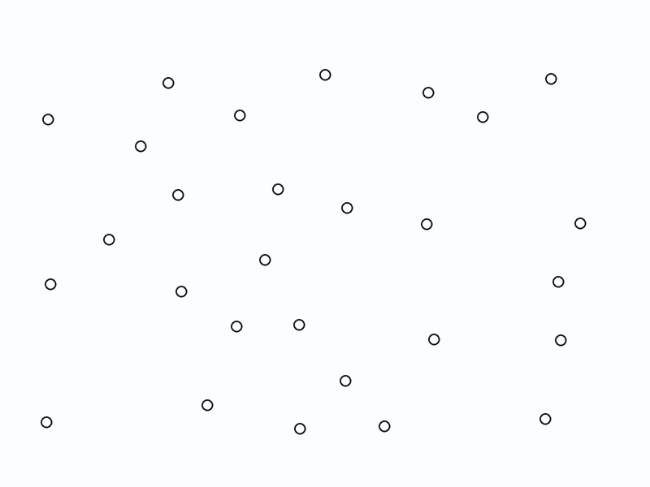
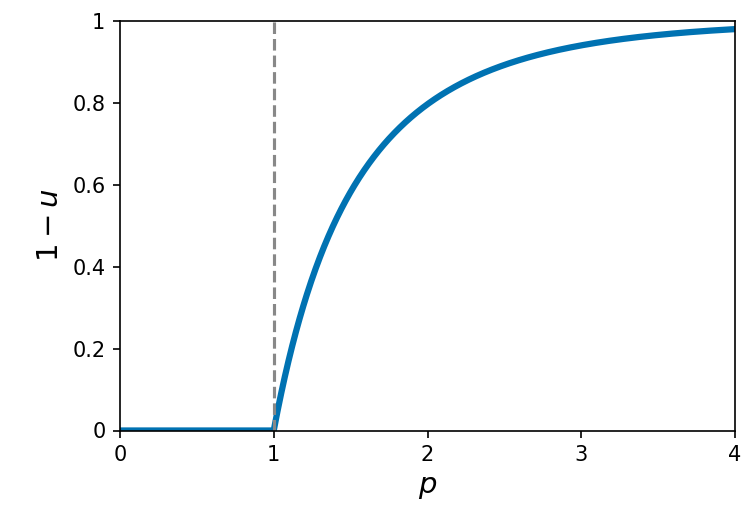

[**Could be worse**](https://www.youtube.com/watch?v=GPfKEhFh9ww) - Random topics in statistical physics, spin glasses, optimization and average case hardness

# The random minimum spanning tree problem

@def title = "The ζ(3) ground state of the random minimum spanning tree"
@def authors = "E. Malatesta"
@def published = "23 November 2026"
@def pt_lang = false
@def rss_pubdate = Date(2026, 11, 23)
@def rss = "random_mst_zeta3"
@def rss_description = "Kruskal's algorithm, the sparse Erdős–Rényi process, and Frieze's derivation of the ζ(3) ground-state energy of the random minimum spanning tree"

{{ published }} | **{{ authors }}**

@@post-top-nav
[← All blog posts](/pages/blog/)
@@

Consider the complete graph $K_N$ and assign an independent random variable weight $L_e$ to every edge $e$. 

Let $E_N$ be the total length of its minimum spanning tree (MST)

$$
E_N=\sum_{e\in\operatorname{MST}}L_e.
$$

From a statistical-physics point of view, $E_N$ is the ground-state energy of the spanning-tree problem. A beautiful result proved by Frieze [\cite{Frieze1985}] states that, if the lengths $L_e$ are uniform on $[0,1]$, then

$$
\lim_{N\to\infty}\mathbb E[E_N]
=
\zeta(3)
=
\sum_{k=1}^{\infty}\frac{1}{k^3}
\simeq 1.2020569.
$$

In this post I want to derive the result by translating Kruskal's algorithm into the language of the Erdős–Rényi random-graph process [\cite{ErdosRenyi1960}]. The logic is the following. Kruskal's algorithm first turns the optimal cost into an integral over the number of connected components of a threshold graph. At edge-length scale $t/N$, this threshold graph is the sparse Erdős–Rényi graph $G(N,t/N)$. Its connected-component density can be written compactly in terms of the fraction $u(t)$ of vertices outside the giant component. Finally, expanding the same density by the size of its finite trees produces one term $1/k^3$ for each tree size $k$.

@@toc-title
Contents
@@
\toc

## Kruskal's algorithm

Kruskal's algorithm [\cite{Kruskal1956}] constructs an MST by sorting all the edges in increasing order of weight and then inspecting them one at a time. An edge is accepted if and only if its endpoints currently belong to two different connected components. If they are already connected, the edge is rejected because it would create a cycle. The algorithm stops after $N-1$ edges have been accepted.

The evolving set of accepted edges is therefore always a forest. Every accepted edge merges two of its connected components, and after $N-1$ successful mergers only one component remains.

The standard implementation sorts the $M$ edges in $O(M\log M)$ time and maintains the components with a [disjoint-set, or union--find, data structure](https://en.wikipedia.org/wiki/Disjoint-set_data_structure). The union--find operations take $O(M\alpha(N))$ time, where $\alpha$ is the inverse Ackermann function, so sorting dominates. For the complete graph, $M=\binom N2$, and the total running time is

$$
O(M\log M)=O(N^2\log N).
$$

We show below a visual implementation of Kruskal's algorithm, for $N=28$ and vertices drawn uniformly on the unit square. The weight of each edge is given by the Euclidean distance between the endpoints of the edge. This problem is usually called the Euclidean MST problem.  
\label{fig-kruskal-euclidean}
@@center

@@
@@center
*Figure 1: Kruskal's algorithm on a complete graph with Euclidean edge weights.*
@@

## The integral representation of the optimal cost

For $\ell\geq0$, let $\mathcal{G}(N, \ell) = \bigl([N],\{e:L_e\leq\ell\}\bigr)$ be the graph with $N$ vertices containing all edges with length at most $\ell$, and denote its number of connected components by $\mathcal{C}_N(\ell)$. Note that since every edge belongs to $\mathcal{G}(N, \ell)$ independently with probability $\mathbb P(L_e\leq \ell)=\ell$, $\mathcal{G}(N, \ell)$ is exactly an Erdős–Rényi random graph. 

Let $w_1,\ldots,w_{N-1}$ denote the lengths of the $N-1$ edges in the minimum spanning tree of the complete graph $K_N$, for a given realization of the random variables $L_e$. Using the identity $x=\int_0^\infty d\ell\,\Theta(x-\ell)$ where $\Theta(\bullet)$ is the Heaviside function, we can write 

$$
E_N
=
\sum_{i=1}^{N-1}w_i
=
\int_0^\infty d\ell\,
\mathcal{N}(\ell)
$$
where $\mathcal{N}(\ell) = \sum_i \Theta(w_i-\ell)$ is the number of weights in the minimum spanning tree larger than the threshold $\ell$. 

The quantity in the integrand has a direct interpretation in terms of Kruskal's algorithm. When we reach level $\ell$, Kruskal's algorithm has built a spanning tree inside every component of $\mathcal{G}(N, \ell)$. If those components have sizes $n_1,\ldots,n_{\mathcal{C}}$, the number of edges already accepted is

$$
\sum_{a=1}^{\mathcal{C}}(n_a-1)
=
N-\mathcal{C}_N(\ell).
$$

Since the MST contains $N-1$ edges, the number of selected edges still missing at level $\ell$, i.e. $\mathcal{N}(\ell)$, is

$$
\mathcal{N}(\ell) = (N-1)-\bigl(N-\mathcal{C}_N(\ell)\bigr)
=
\mathcal{C}_N(\ell)-1.
$$

so that the energy for a realization of the weights

$$
\label{eq::mst_component_integral}
\boxed{
E_N
=
\int_0^\infty d\ell\,
\bigl[\mathcal{C}_N(\ell)-1\bigr].
}
$$
Making the change of variables $\ell=p/N$, taking the expectation, and sending $N\to \infty$ we therefore get
$$
\label{eq::scaled_component_integral}
\boxed{
\lim_{N\to \infty} \mathbb{E} [E_N]
=
\int_0^\infty dp\,
\kappa(p).
}
$$
where we have defined 
$$
\label{eq::kappa}
\kappa(p) = \lim_{N\to\infty}\frac{1}{N}\mathbb{E} \left[\mathcal{C}_N\!\left(\frac{p}{N} \right)-1\right]
$$

## The Erdős–Rényi random graph

We would like now to determine the expected number of connected components of an Erdős–Rényi random graph with edge probability scaling as $\ell = \frac{p}{N}$. To do that, it is useful to recall some properties of the Erdős–Rényi random graph ensemble $\mathcal{G}(N,p/N)$. 

Note that the scaling $\ell = \frac{p}{N}$ makes the probability of a vertex $i$ to have degree $\mathrm{deg}_i$ equal to $k$ Poissonian distributed in the large $N$ limit. Indeed
$$
\label{eq::poissonian}
P[\mathrm{deg}_i=k] = \binom{N-1}{k}
\left(\frac{p}{N}\right)^k
\left(1-\frac{p}{N}\right)^{N-1-k} \; \xrightarrow{N \to \infty} \;
e^{-p}\frac{p^k}{k!}.
$$
Note that therefore $p$ represents the mean degree when $N$ is large: $p = \mathbb{E}[\mathrm{deg}_i]$. 

### Locally tree-like property

What does an Erdős–Rényi graph look like *locally*? In order to answer this question, we take a vertex $i$ at random, and we ask what is the probability that $i$ is belongs to a cycle $\omega_s$ of length s? To answer, let's start from $i$; I have $N-1$ possibilities to connect with another node $i_1$ and this happens with probability $p/N$. Then from $i_1$ I can choose another vertex $i_2$ in $N-2$ ways with probability $p/N$. I iterate this procedure until I get to node $i_{s-1}$ after which I have to come back to vertex $i$. We therefore have
$$
\begin{aligned}
P[i \in \omega_s] &= \frac{1}{2} (N-1) \frac{p}{N} (N-2) \frac{p}{N} \dots (N-s+1) \frac{p}{N} \cdot \frac{p}{N} \simeq \frac{p^s}{2N}
\end{aligned}
$$
where the factor $1/2$ is added to avoid double counting (since the loop can be travelled starting from $i$ in two possible directions). This probability goes to zero in the limit of large $N$. This means that if one takes a random node $i$ and looks to a *finite neighborhood* $s$ with high probability we will not see any loop. This property is called *tree-like property* of the Erdős–Rényi random graph. From this also follows that the expected number of loops of length $s$
$$
\label{eq::loops}
\mathbb{E} [\mathcal{L}_s] \simeq \frac{p^s}{2N} \frac{N}{s} = \frac{p^s}{2s}
$$
is of order 1 and does not scale with $N$. The factor $N/s$ has a simple origin. Multiplying by $N$ sums over the possible choices of a marked vertex $i$. In this way, however, every cycle of length $s$ is counted $s$ times, once for each of its vertices. We must therefore divide by $s$. For $p<1$, equation \eqref{eq::loops} shows that $\mathbb E[\mathcal L_s]$ decreases exponentially with $s$, so cycles are rare and a vertex chosen uniformly at random does not belong to any loop. 

A similar argument also determines the typical component size. Starting from vertex $i$, on average it has $p$ neighbors; each of them has, on average, $p$ neighbours. For $p<1$ one therefore gets
$$
\mathbb E[|\mathcal C(i)|]\simeq\sum_{s=0}^{\infty} p^s = \frac{1}{1-p},
$$
so a typical vertex belongs to a finite component of size $O(1)$, which is a tree with high probability. For $p>1$, the exploration may instead continue growing as $p^r$. When $p>1$ instead, the size of the connected component scales as $p^s$; when this quantity becomes of order $N$ loops can appear. The typical length of a loop when $p>1$ is therefore 
$$
s \simeq \frac{\ln N}{\ln p}
$$
 

### The equation for the giant component

The exploration argument above suggests a qualitative change at $p=1$. For $p<1$, the number of newly discovered vertices decreases on average and the exploration eventually stops, producing a finite component. For $p>1$, it grows on average and has a positive probability of reaching an extensive number of nodes of the graph. In the large-$N$ limit, this produces a unique component containing order-$N$ vertices, known as the *giant component*. We now determine the fraction of vertices belonging to it.

Let us denote by $u(p)$ the fraction of vertices *not belonging* to the giant component. For a vertex $i$ not to belong to the giant component, it must not be connected to any other vertex that belongs to the giant component. For every vertex $j\ne i$, one of the following must occur:

- vertex $j$ does not belong to the neighborhood of node $i$, i.e. $j \notin \partial i$. This event happens with probability $1-\frac{p}{N}$;
- $j \in \partial i$, but $j$ is not in the giant component; this event has probability $\frac{p}{N} u$.

The total probability that $i$ does not belong to the giant component is therefore $1- \frac{p}{N} + \frac{p}{N} u$. For $i$ to be disconnected from the giant component this must be true for all the $N-1$ possible choices of $j$, so that[^1]
$$
\label{eq::u_self_consistency}
 u = \left(1 - \frac{p(1-u)}{N}\right)^{N-1} \; \xrightarrow{N\to\infty} \; u = e^{-p(1-u)}. 
$$

The emergence of the giant component is illustrated in [Figure 2](#fig-giant-component), where the fraction $1-u$ of vertices belonging to it is plotted as a function of the mean degree $p$.

\label{#fig-giant-component}
@@center  @@
@@center *Figure 2: Fraction $1-u$ of vertices belonging to the giant component as a function of the mean degree $p$. For $p\leq1$, the physical solution is $u=1$ and no giant component is present. For $p>1$, a nonzero giant component emerges continuously, with $u$ determined by $u=e^{-p(1-u)}$.* @@

### The graph outside the giant component

In the previous section we have found how the giant component emerges. However, this does not count in the number of connected components $\mathcal{C}_N(\ell)$ when $N$ is large (recall equation \eqref{eq::kappa}). We therefore need to examine how typically an Erdős–Rényi random graph looks like for vertices not belonging to the giant component.

Choose uniformly at random a vertex $i$ not belonging to the giant component $i \notin \mathrm{gc}$. We would like to compute what is the probability that it has degree $k$. For $i$ to remain outside the giant component, given it has degree $k$, it must be that none of its $k$ neighbouring branches reaches the giant component. 
Each branch is not in the giant component with probability $u$, and therefore

$$
P[i \notin \mathrm{gc} \mid \mathrm{deg}_i=k]=u^k.
$$

Using Bayes' rule, we obtain

$$
\begin{aligned}
P[\mathrm{deg}_i=k \mid i \notin \mathrm{gc}]
&=
\frac{
P[i \notin \mathrm{gc} \mid \mathrm{deg}_i=k] P[\mathrm{deg}_i=k]
}{
P[\mathrm{gc}]
}\\
&=
\frac{u^k}{u}
e^{-p}\frac{p^k}{k!}.
\end{aligned}
$$

The self-consistency equation \eqref{eq::u_self_consistency} implies

$$
\frac{e^{-p}}{u}=e^{-pu}.
$$

Hence when we condition on a random vertex $i$ not belonging to the giant component the probability it has degree equal to $k$

$$
P[\mathrm{deg}_i=k \mid i \notin \mathrm{gc}]
=
e^{-pu}\frac{(pu)^k}{k!}.
$$

is still Poissonian but with a mean degree $pu$. Crucially, this effective mean is smaller than one. Taking the logarithm of the equation \eqref{eq::u_self_consistency} gives

$$
p=\frac{-\log u}{1-u} \implies pu=\frac{-u\log u}{1-u}.
$$

For $0 < u < 1$,

$$
-u\log u = \int_u^1\frac{u}{x}\,dx < \int_u^1 dx = 1-u.
$$

from which it follows that $pu <1$.

Thus, although the original graph is in the supercritical phase $p>1$, the graph outside the giant component (composed by $uN$ vertices) behaves asymptotically as an Erdős–Rényi random graph in the subcritical $q<1$ phase:

$$
\mathcal{G}\left(uN,\frac{p}{N}\right)
=
\mathcal{G}\left(uN,\frac{q}{uN}\right),
\qquad q\equiv pu<1.
$$

This property is known as the *duality principle*.

We can summarize the evolution of $\mathcal{G}(N,p/N)$ as $p$ increases as follows:

- for $p<1$, a vertex chosen at random is located in a tree with high probability; it is possible to show that the largest components have size $O(\log N)$;
- at $p=1$, it is possible to show that the largest components have size $O(N^{2/3})$;
- for $p>1$, a unique giant component of size $(1-u)N$ appears, while the graph outside the giant is effectively subcritical, with mean degree $pu<1$. Therefore a uniformly chosen vertex, conditioned on lying outside the giant component, belongs to a tree component with high probability;
- when $p$ is of order $\log N$ the graph becomes connected.

### Counting the number of trees

From the analysis of the previous section we found that the number of connected components of an Erdős–Rényi random graph is dominated by trees. Now we will compute explicitly the number of tree components. Let $T_{N,k}$ be the number of tree components containing exactly $k$ vertices in $\mathcal{G}\left(N,\frac{p}{N}\right)$. We can count the expected value of $T_{N,k}$ by the following reasoning. 

- Choose $k$ vertices out of the $N$ available; there are $\binom Nk$ possibilities;
- From those $k$ vertices Cayley's formula tells us that we can construct $k^{k-2}$ spanning trees; 
- Then we have to require that the $k-1$ edges of out $k$ vertex tree are present. This happens with probability $\left(\frac{p}{N}\right)^{k-1}$;
- Next we have to assure that no other edges are present between our $k$ vertices: this event has probability $\left(1-\frac{p}{N}\right)^{\binom{k}{2}-(k-1)}$;
- Finally we have to impose that there are no edges between these $k$ vertices and the remaining $N-k$: this gives an additional factor $\left(1-\frac{p}{N}\right)^{k(N-k)}$

Therefore, putting all the mentioned factors together, we have
$$
\mathbb E[T_{N, k}]
=
\binom Nk k^{k-2}
\left(\frac{p}{N}\right)^{k-1}
\left(1-\frac{p}{N}\right)^{
k(N-k)+\binom{k}{2}-(k-1)
}.
$$
For fixed $k$ and large $N$, we obtain
$$
\begin{aligned}
\mathbb E[T_{N, k}]
&\simeq
\frac{N^k}{k!} k^{k-2}
\left(\frac{p}{N}\right)^{k-1} e^{-k p} \\
&=N \frac{k^{k-2}}{k!}
p^{k-1} e^{-k p} 
\end{aligned}
$$

Summing over $k$ and dividing by $N$ we finally get
$$
\label{eq::kappa_tree_expansion}
\boxed{
\kappa(p)
=
\sum_{k\ge1}
\frac{k^{k-2}}{k!}
p^{k-1}e^{-kp}.
}
$$

## The algebra leading to $\zeta(3)$

Substituting equation \eqref{eq::kappa_tree_expansion} into equation \eqref{eq::scaled_component_integral} gives

$$
\lim_{N\to\infty}\mathbb E[E_N]
=
\sum_{k\geq1}
\frac{k^{k-2}}{k!}
\int_0^\infty dp\,p^{k-1}e^{-kp}\,,
$$

where Tonelli’s theorem allows us to exchange the sum and the integral because all terms are nonnegative. With $x=k p$,

$$
\begin{split}
\int_0^\infty dp\,p^{k-1}e^{-kp}
&=
\frac{1}{k^k}
\int_0^\infty dx\,x^{k-1}e^{-x}\\
&=
\frac{\Gamma(k)}{k^k}
=
\frac{(k-1)!}{k^k}.
\end{split}
$$

Therefore we find

$$
\lim_{N\to\infty}\mathbb E[E_N]
=
\sum_{k=1}^{\infty}
\frac{k^{k-2}}{k!}
\frac{(k-1)!}{k^k} =
\sum_{k=1}^{\infty}\frac{1}{k^3} = \zeta(3).
$$

<!-- ## The component density in terms of $u$

We can now count the finite components (i.e. whose size do not grow with $N$). There are asymptotically

$$
V_{\mathrm{fin}}=uN+o(N)
$$

vertices outside the giant component. Now consider the number $M_{\mathrm{fin}}$ of edges whose endpoints lie in finite components.
The total number of possible edges is approximately $N^2/2$, each present with probability $p/N$. At leading order, the probability that both endpoints do not pertain to the giant component is $u^2$. Therefore
$$
M_{\mathrm{fin}}
\simeq
\frac{N^2}{2}\frac tN u^2
=
\frac t2u^2N.
$$

For any graph, the number of components equals the number of vertices minus the number of edges plus the total cycle rank. The cycle rank of the finite components of $\mathcal{G}(N,p/N)$ is $o(N)$, including at the critical point. Hence the number of finite components is

$$
\begin{split}
\mathcal{C}_{\mathrm{fin}}
&=
V_{\mathrm{fin}}-M_{\mathrm{fin}}+o(N)\\
&=
N\left(u-\frac{t}{2}u^2\right)+o(N).
\end{split}
$$

For $t>1$, the total component count is $1+C_{\mathrm{fin}}$, where the additional component is the giant. For $t\leq1$ there is no giant, but subtracting one changes the normalized count only by $1/N$. Both regimes are therefore described by the same limiting integrand:

$$
\label{eq::kappa_u}
\boxed{
\kappa(t)
\equiv
\lim_{N\to\infty}
\frac{C_N(t/N)-1}{N}
=
u-\frac{t}{2}u^2,
\qquad
u=e^{-t(1-u)}.
}
$$

For $t\leq1$, $u=1$ and $\kappa(t)=1-t/2$. For $t>1$, $u<1$ and the same formula counts the density of finite components outside the giant.

Using equation \eqref{eq::scaled_component_integral}, the limiting average optimal cost becomes[^1]

$$
\label{eq::energy_kappa}
\lim_{N\to\infty}\mathbb E[E_N]
=
\int_0^\infty dt\,\kappa(t)
=
\int_0^\infty dt\,
\left(u-\frac{t}{2}u^2\right).
$$
-->

#

<!-- FOOTNOTES -->

[^1]: Another way of deriving this result is to use the Poissonian degree distribution of the vertices derived in equation \eqref{eq::poissonian}. Since each of the $k$ neighbours of vertex $i$ independently fails to belong to the giant component with probability $u$, the probability that none of them belongs to it is $u^k$. We have $$u = \sum_{k=0}^{\infty} P[\mathrm{deg}_i = k] u^k = e^{-p} \sum_{k=0}^{\infty} \frac{(pu)^k}{k!} = e^{-p(1-u)} $$ which is \eqref{eq::u_self_consistency}.

@@notoc
References
@@

[1] \biblabel{Frieze1985}{Frieze (1985)} A. M. Frieze, "On the Value of a Random Minimum Spanning Tree Problem", *Discrete Applied Mathematics* **10**, 47--56 (1985). [doi:10.1016/0166-218X(85)90058-7](https://doi.org/10.1016/0166-218X(85)90058-7).

[2] \biblabel{ErdosRenyi1960}{Erdős and Rényi (1960)} P. Erdős and A. Rényi, "On the Evolution of Random Graphs", *Publication of the Mathematical Institute of the Hungarian Academy of Sciences* **5**, 17--61 (1960).

[3] \biblabel{Kruskal1956}{Kruskal (1956)} J. B. Kruskal, "On the Shortest Spanning Subtree of a Graph and the Traveling Salesman Problem", *Proceedings of the American Mathematical Society* **7**, 48--50 (1956).

{{ blogcomments }}
